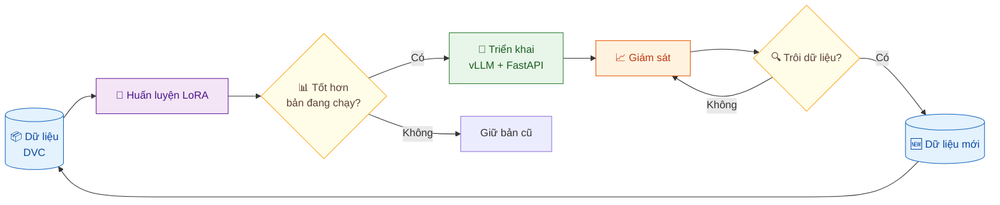

# vi-toxic-mlops
# MLOps Pipeline for Vietnamese Toxic Comment Moderation with Fine-tuned LLMs

## A. Mục tiêu tổng thể

Xây dựng hệ thống vận hành học máy trọn vòng đời cho bài toán kiểm duyệt bình luận độc hại tiếng Việt.

- **Đầu vào:** một bình luận.
- **Đầu ra:** một trong ba nhãn `CLEAN` / `OFFENSIVE` / `HATE`.

Trọng tâm là **quy trình vận hành**, không phải chạy đua chỉ số mô hình:

- Huấn luyện tái lập được bằng một lệnh.
- Kiểm thử và đóng gói Docker tự động qua CI.
- Triển khai API suy luận độ trễ thấp.
- Giám sát hệ thống và trôi dữ liệu.
- Tự động huấn luyện lại khi ngôn ngữ mạng (từ lóng, teencode) thay đổi; chỉ triển khai bản mới nếu tốt hơn bản đang chạy.



## B. Framework và cách tích hợp

Framework chính: **Hugging Face Transformers + PEFT** (huấn luyện) và **vLLM** (phục vụ).

- **Transformers:** nạp mô hình tiền huấn luyện và tokenizer từ Hugging Face Hub; dùng `Trainer` cho vòng huấn luyện.
- **PEFT (LoRA):** chỉ huấn luyện bộ trọng số LoRA nhỏ (vài chục MB), dễ lưu trữ và quản lý phiên bản.
- **vLLM:** nạp mô hình gốc kèm bộ LoRA, cung cấp API suy luận hiệu năng cao; bọc thêm một lớp FastAPI.

Quy trình xung quanh dùng thêm:
- **Cấu hình và tái lập:** Hydra, Docker.
- **Kiểm thử và CI:** pytest, GitHub Actions.
- **Quản lý dữ liệu và thí nghiệm:** DVC, Weights & Biases.
- **Giám sát:** Prometheus, Grafana, Evidently.

## C. Dữ liệu

**ViHSD** – Vietnamese Hate Speech Detection Dataset (UIT): https://huggingface.co/datasets/sonlam1102/vihsd

- **Quy mô:** khoảng 33.400 bình luận Facebook và YouTube, chia sẵn 24.048 huấn luyện / 2.672 kiểm định / 6.680 kiểm tra.
- **Nhãn:** `CLEAN`, `OFFENSIVE`, `HATE`. Dữ liệu mất cân bằng nên chỉ số chính là **macro-F1**.
- **Mô phỏng dữ liệu mới:** tách một phần tập huấn luyện thành các đợt dữ liệu đến dần. Có thể chèn nhiễu teencode để tạo trôi dữ liệu, phục vụ kiểm chứng vòng huấn luyện lại.

*Dữ liệu có thể thay đổi trong quá trình thực hiện.*

## D. Mô hình dự kiến

| Mô hình | Vai trò |
|---|---|
| TF-IDF + Logistic Regression | Mốc so sánh, chạy nhanh trên CPU, dùng trong CI |
| Qwen2.5-1.5B-Instruct (chưa tinh chỉnh) | Mốc so sánh: chỉ dùng câu chỉ dẫn |
| **Qwen2.5-1.5B-Instruct + LoRA** | **Mô hình chính**, tinh chỉnh trên ViHSD, phục vụ bằng vLLM |
| Qwen2.5-3B-Instruct + LoRA | Mở rộng nếu còn thời gian, so sánh đánh đổi độ chính xác – độ trễ |

## E. Cách chạy

Yêu cầu: máy Linux có GPU NVIDIA (đã thử trên 2× RTX 4090), Docker + NVIDIA Container Toolkit, [uv](https://docs.astral.sh/uv/).

```bash
cp .env.example .env          # điền HF_TOKEN (bấm "Agree" tại huggingface.co/datasets/uitnlp/vihsd), WANDB_API_KEY (tuỳ chọn)
make help                     # liệt kê lệnh
make e2e                      # chạy toàn bộ kịch bản end-to-end (scripts/e2e.sh)
```

Từng bước:

| Lệnh | Việc làm |
|---|---|
| `make setup` | Cài môi trường Python trên host (không cần torch), cấu hình DVC remote cục bộ |
| `make data` | Tải ViHSD, chia `train_base` (70%) + 3 đợt dữ liệu đến dần (teencode 0% / 40% / 80%) + `test_teencode` |
| `make baseline` | TF-IDF + LogReg (mốc so sánh, đồng thời là mô hình dự phòng của API) |
| `make build && make serve` | vLLM (GPU1) + FastAPI + Prometheus + Grafana |
| `make eval-zeroshot` | Đánh giá Qwen gốc chỉ dùng câu chỉ dẫn |
| `make train ARGS="train.run_id=v1"` | Huấn luyện LoRA trên GPU0 (Hydra override được mọi tham số, vd. `model=qwen2.5-3b`) |
| `make promote RUN=v1` | Đánh giá lại candidate và production trên cùng tập, chỉ triển khai nếu tốt hơn `min_delta` |
| `make simulate SOURCE=batch_3` | Bắn lưu lượng vào API |
| `make drift` | Kiểm tra trôi dữ liệu trên log API (KS test + báo cáo Evidently HTML) |
| `make retrain UPTO=3` | Vòng tự động: drift? → gộp dữ liệu mới → train → so sánh → triển khai |
| `make repro` | Tái lập `prepare → baseline → train` bằng DVC |
| `make test` | pytest (CI chạy thêm ruff + build Docker) |

Dịch vụ: API `:8000` (`/predict`, `/predict/batch`, `/health`, `/model`, `/metrics`), vLLM `:8001`, Prometheus `:9090`, Grafana `:3000` (dashboard *vi-toxic moderation*).

### Kiến trúc mã nguồn

```
configs/                 Hydra: config.yaml + model/{qwen2.5-1.5b,qwen2.5-3b}.yaml
src/vitoxic/
  labels.py              Nhãn, prompt, parse đầu ra (dùng chung train/eval/serve)
  data/prepare.py        Tải + chuẩn hoá + chia đợt dữ liệu; data/teencode.py: sinh nhiễu teencode
  baseline.py            TF-IDF + LogReg
  train_lora.py          Transformers Trainer + PEFT LoRA, chỉ tính loss trên phần nhãn
  evaluate.py            Đánh giá mô hình đang phục vụ trên vLLM (macro-F1, độ trễ, throughput)
  promote.py, registry.py  Cổng triển khai + registry dạng file (models/registry/production.json)
  serving/app.py         FastAPI: tự nạp LoRA production vào vLLM lúc chạy, log yêu cầu, metric, dự phòng TF-IDF
  monitoring/drift.py    Đặc trưng văn bản + KS test + Evidently
  pipeline/retrain.py    Vòng huấn luyện lại tự động
docker/, docker-compose.yml, monitoring/ (Prometheus, Grafana), dvc.yaml, .github/workflows/ci.yml
```
